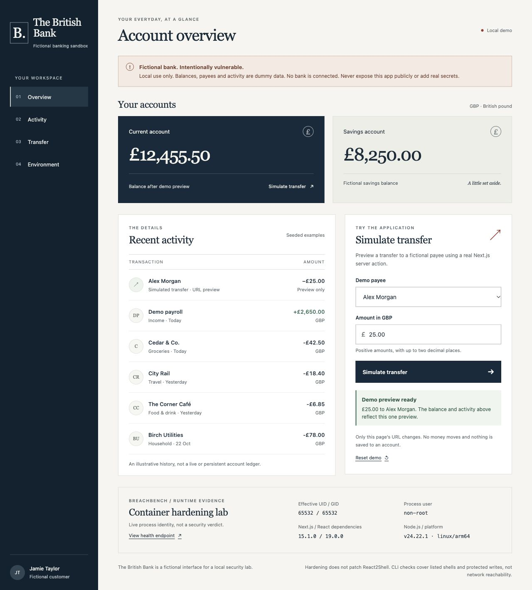

# BreachBench 

<p align="center">
    <picture>
      <source srcset="docs/logo.svg">
      
  </picture>
</p>

BreachBench runs adversarial security benchmarks against deterministically generated OCI container images

Built on the OCI Community’s [Container Hardening Work Bench](https://gitlab.opencode.de/oci-community/tools/container-hardening-work-bench).

## One image in, a hardened candidate out

```sh
go build -o bin/breachbench .
./bin/breachbench your-app:original
```

Or launch `./bin/breachbench` and enter the image at the prompt. It shows detected
tools, startup constraints and identity, then creates a fresh local image and
saves evidence automatically under `demo/runs/`. It prints the complete
`docker run` command and saves a short `run.sh` launcher with the runtime protections.
No target tag, temporary-directory variable, workload JSON or policy JSON is needed.
The original image is never overwritten or started during this static flow.

Existing Gemini environment/Keychain credentials are reused for Argon. Use
`--mode tools` to use deterministic tools without an API key; there is no silent
fallback when a requested AI call fails. `harden-image IMAGE` is an explicit
alias; the older source-folder and advanced `harden` commands still work.

For the local British Bank browser demo (requires Docker Engine 28+):

```sh
./bin/breachbench local/react2shell:unhardened --demo
```

Copy the printed Docker command. For this image it prefers `127.0.0.1:3001` to
the declared container port `3000`, choosing a free local port if 3001 is busy;
leave the original demo on port 3000 for a
side-by-side comparison. `--demo` opts into bridge networking: **outbound access
is allowed**, not blocked. It publishes only the first declared TCP port on
loopback, preferring container port + 1 on the host (65535 uses 65534). Port
availability can change after generation; if so, change it in the printed command.
Without `--demo`, networking
is disabled and no ports are published. EXPOSE is a hint, not proof of a website.

The output is a **static candidate, not runtime-tested**. Necessary tools may
remain; dynamic dependencies, writable paths and external services cannot be
proven from an image alone. Declared persistent volumes still require explicit
review and are not silently replaced with temporary storage. Image-level
hardening alone cannot enforce read-only/capability/network protections: use
the printed command or launcher. This does not patch React2Shell or prove that
runtime code execution is prevented. Docker Engine versions below 28 are refused
for `--demo`: [Docker documents that localhost-published ports on older engines
can be reached from the same L2 network](https://docs.docker.com/engine/network/port-publishing/).
This restriction does not block hardening without `--demo`. The existing
Node-only [browser forwarder](docs/react2shell-browser-demo.md) remains the
isolated, no-published-container-port path for the bank fixture on older engines.

## Application hardening

Run the isolated before/after demo with `go run . harden demo /absolute/path/to/new-results`.
It saves an HTML report and JSON evidence; see [the demo guide](docs/hardening-demo.md).

`go run . harden /path/to/app` generates minimal images and runtime policies for
Go, Node/Next.js and PHP-FPM. Use `harden detect`, `harden build` and `harden verify`
to review requirements, build the image, and check runtime restrictions.

See [application hardening](docs/application-hardening.md) for configuration,
Kubernetes/Compose deployment, and the limits of automatic inference.

## Harden an existing application image

For **static-only** hardening, without starting the application or any probes:

```sh
go build -o bin/breachbench .
static_parent=$(mktemp -d /tmp/breachbench-static.XXXXXX)
./bin/breachbench harden static \
  --image your-app:original --target your-app:static-candidate \
  --artifacts "$static_parent/results" --format human
```

Argon calls bounded inspection, tool-selection and apply tools. Existing Gemini
Keychain credentials are reused; add `--mode tools` for deterministic operation
without an API key. No workload JSON is needed. The output is an **untested
candidate**, not proof that the application still works or an exploit is blocked.
Read-only/non-root/capability/network controls are supplied in `compose.json`;
the default denies network access and may break application features. See
[static-only limits and policy overrides](docs/image-hardening.md#static-only-hardening).

The supplied-image workflow preserves application/runtime versions, removes
selected unnecessary tool entrypoints, and compares application checks under a
non-root/read-only runtime. It does not patch vulnerabilities or require Node in
the image for its probes.

```sh
go build -o bin/breachbench .
demo_parent=$(mktemp -d /tmp/breachbench-image.XXXXXX)
./bin/breachbench harden auto \
  --image local/react2shell:unhardened \
  --target "local/react2shell:hardened-$(basename "$demo_parent")" \
  --checks fixtures/react2shell/workload.json \
  --policy fixtures/react2shell/policy.json --artifacts "$demo_parent/results"
cat "$demo_parent/results/comparison.md"
```

This starts from an existing local image and uses deterministic tools without an
API key. `harden agent` uses Argon for bounded tool selection; existing macOS
Keychain configuration is reused automatically. Runtime controls require the
generated `compose.json`, not just the candidate image. No remote exploit is
attempted, and hardening does not fix React2Shell.

See [image hardening](docs/image-hardening.md) for workload/policy formats,
credentials, evidence and limitations. The imported commands are also available
under `harden image`; native `harden APP`, `harden build`, `harden verify` and
`harden demo` remain unchanged. The imported implementation retains its
[L3montree MIT notice](internal/imagehardening/LICENSE.md).

`harden auto` and `harden agent` show progress and a readable before/after table
on a terminal. Use `--format human` to force that view or `--format json` for
automation; `report.json` is always retained. See the
[browser demo](docs/react2shell-browser-demo.md) for The British Bank, a fictional
GBP banking sandbox on the real, intentionally vulnerable Next.js application.
It uses dummy balances and a transfer-preview Server Action, with no real money,
login, customer data or payment integration.



## Credentials

Keep API keys in the existing macOS Keychain configuration or environment, never
in source files, command arguments, reports or Git commits. `.env` files, built
binaries and raw demo-run artifacts are ignored. Rotate any key shared in chat
or logs; removing it from a file does not revoke it.

The repository's `.gitleaks.toml` extends the standard rules with a check for
AQ-prefixed credentials. Before publishing, scan both files and all Git refs:

```sh
gitleaks dir --redact=100
gitleaks git --redact=100 --log-opts="--all --full-history --root --diff-merges=first-parent"
```

## Dockerfile runtime stage tracing & GitHub scraper

`go run . trace [path/to/Dockerfile]` (or `go run . harden trace`) implements automated
4-step Dockerfile runtime stage tracing:
1. Identifies the deployed stage (`--target` or the last stage by default).
2. Follows the `FROM` inheritance chain across named stages and `ARG` / `--build-arg` values back to the external runtime base image.
3. Resolves effective `ENTRYPOINT` and `CMD` across the `FROM` chain and known base image defaults.
4. Traces the startup executable's origin (`COPY --from=<stage>`, transitive multi-stage copies, build context copies, or in-stage builds) so an executable built in Go/Rust/Node and copied into a minimal/static image is distinguished from a container that inherits and runs inside its build environment (`FROM build AS runtime` or single-stage toolchain builds).

`go run . scrape --output /path/to/scrape-results` queries GitHub's most popular repositories,
fetches and traces their Dockerfiles, and generates JSON, Markdown, and HTML reports highlighting
unhardened single-stage and build-environment-inheriting Dockerfiles.

TODO:

Mandatory:

What is a OCI Container/Docker Container?
How does Container Hardening work?

# Defensive Security Capabilities


- [ ] Configuration files
- [ ] Cross Container Communication (IaC) Kubernetes Rules
- [ ] Rego Policy Tools


# Offensive Security Capabilities:


Make sure AI is really only allowed to be attacking this one sandbox, only target, no cheesing - Luca
- [ ] Simulated Benchmarks (Sandbox) - Lars (pwned, or not pwned)
- [ ] Github Bot implementation - Lars (optional)


# FAQ

> Why don't I just use Distroless?

[Distroless does not cover any Application](https://github.com/GoogleContainerTools/distroless#what-images-are-available)

[Other Tradeoffs, such as Maintainability & Shipping are difficult](https://docs.docker.com/dhi/explore/security-concepts/distroless/#addressing-common-tradeoffs)

Made without Agents
