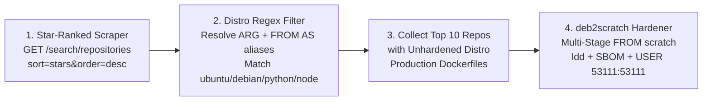

# 🛡️ BreachBench GitHub Hardening Bot — Top-10 Most-Starred Distro Dockerfile Scraper & Hardener

## 1. Executive Summary & Pipeline Overview

For the final presentation slide of **BreachBench**, we built an autonomous **Top-Starred GitHub Repository Scraper + Distro Regex Detector + `deb2scratch` Hardener (`harden-pr`)** in both the Go CLI ([`breachbench/cmd/harden_pr.go`](file:///Users/luca/Desktop/EncodeHubHackathon/breachbench/cmd/harden_pr.go)) and the standalone Python runner ([`scripts/harden_pr.py`](file:///Users/luca/Desktop/EncodeHubHackathon/scripts/harden_pr.py)).

Instead of blindly checking only the top 10 repositories on GitHub (many of which are markdown books or roadmaps without containers), the scraper walks down GitHub's most-starred repositories (`sort=stars&order=desc`) until it collects **10 actual repositories that contain an unhardened distro-based `Dockerfile`**, pulls each `Dockerfile`, and transforms it into a hardened multi-stage `FROM scratch` (`USER 53111:53111`) build.



---

## 2. Distro Base Image Regex & Multi-Stage Alias Resolution

Implemented in [`IsUnhardenedDistroDockerfile`](file:///Users/luca/Desktop/EncodeHubHackathon/breachbench/pkg/hardener/analyzer.go#L41-L86) and [`is_unhardened_distro_dockerfile`](file:///Users/luca/Desktop/EncodeHubHackathon/scripts/harden_pr.py#L80-L124):

1. **Stage & `ARG` Resolution**:
   - Extracts `ARG KEY=DEFAULT` defaults and substitutes `${KEY}` / `$KEY` inside `FROM` lines.
   - Matches every `FROM` directive via:
     ```regex
     (?i)^\s*FROM\s+(?:--platform=\S+\s+)?([^\s#]+)(?:\s+AS\s+([a-zA-Z0-9._-]+))?
     ```
   - Tracks `FROM <base> AS <alias>` stage aliases so multi-stage builds where the final stage references an earlier stage (`FROM base AS runtime`) resolve back to the underlying OS image.
2. **Distro Base Regex Match**:
   - Verifies that the resolved final runtime stage is **not** already `scratch`, `distroless`, or `alpine`, and matches:
     ```regex
     (?i)^(?:docker\.io/|ghcr\.io/)?(?:library/)?(?:ubuntu|debian|python|node|golang|rust|ruby|php|openjdk|buildpack-deps|nvidia/cuda)(?::\S+|@\S+)?$
     ```

---

## 3. Live Scrape Results: Top 10 Most-Starred GitHub Repos with Unhardened Distro `Dockerfile`s

Running:
```bash
python3 scripts/harden_pr.py --top-stars 10 --dry-run -o /tmp/top10_hardened -v
```
scanned the top 82 most-starred repositories on GitHub (automatically skipping markdown-only repos and already-Alpine images like `excalidraw/excalidraw` and `krahets/hello-algo`) to collect and harden the **Top 10**:

| Rank | Repository | Stars | Dockerfile Path | Matched Distro Base Image (`FROM`) | Extracted Runtime Packages (`apt`) | Hardened Target |
| :--- | :--- | ---: | :--- | :--- | :--- | :--- |
| **#1** | `freeCodeCamp/freeCodeCamp` | 457,832 ⭐ | `docker/api/Dockerfile` | `node:24-bookworm` | `jq`, `ca-certificates` | `FROM scratch` (`53111:53111`) |
| **#2** | `openclaw/openclaw` | 392,924 ⭐ | `Dockerfile` | `docker.io/library/node:24.22.1-trixie-slim` | `acl`, `ca-certificates`, `curl`, `e2fsprogs`, `git`, `hostname`, `libgomp1`, `lsof`, `openssl`, `python3`, `tini` | `FROM scratch` (`53111:53111`) |
| **#3** | `NousResearch/hermes-agent` | 256,704 ⭐ | `Dockerfile` | `debian:trixie-20261020` | `ca-certificates`, `tzdata` | `FROM scratch` (`53111:53111`) |
| **#4** | `microsoft/markitdown` | 191,921 ⭐ | `Dockerfile` | `python:3.13-slim-trixie` | `ffmpeg`, `libimage-exiftool-perl`, `git` | `FROM scratch` (`53111:53111`) |
| **#5** | `ollama/ollama` | 184,617 ⭐ | `Dockerfile` | `ubuntu:24.04` | `curl`, `ccache`, `git`, `unzip`, `ca-certificates`, `libvulkan1`, `libopenblas0` | `FROM scratch` (`53111:53111`) |
| **#6** | `f/prompts.chat` | 174,349 ⭐ | `docker/Dockerfile` | `node:24-bookworm-slim` | `openssl`, `curl`, `ca-certificates` | `FROM scratch` (`53111:53111`) |
| **#7** | `langgenius/dify` | 159,418 ⭐ | `api/Dockerfile` | `python:3.13-slim-bookworm` | `git`, `g++`, `libmpfr-dev`, `libmpc-dev`, `ca-certificates`, `curl`, `gnupg`, `libgmp-dev`, `expat`, `perl`, `fonts-noto-cjk`, `libmagic1`, `poppler-utils` | `FROM scratch` (`53111:53111`) |
| **#8** | `open-webui/open-webui` | 156,631 ⭐ | `Dockerfile` | `python:3.11-slim-bookworm` | `curl`, `jq`, `ca-certificates`, `git`, `build-essential`, `pandoc`, `gcc`, `libmariadb-dev`, `ffmpeg`, `libsm6`, `libxext6`, `zstd` | `FROM scratch` (`53111:53111`) |
| **#9** | `harry0703/MoneyPrinterTurbo` | 134,756 ⭐ | `Dockerfile` | `python:3.11-slim-bullseye` | `git`, `ffmpeg` | `FROM scratch` (`53111:53111`) |
| **#10** | `Graphify-Labs/graphify` | 134,204 ⭐ | `Dockerfile` | `python:3.12-slim` | `ca-certificates`, `tzdata` | `FROM scratch` (`53111:53111`) |

---

## 4. Sample Before vs. After Hardening (`ollama/ollama` — 184,617 ⭐)

### Upstream Final Runtime Stage (`ollama/ollama/Dockerfile`)
```dockerfile
FROM ubuntu:24.04
RUN apt-get update && \
    apt-get install -y ca-certificates libvulkan1 libopenblas0 && \
    apt-get clean && rm -rf /var/lib/apt/lists/*
COPY --from=archive /bin /usr/bin
ENV PATH=/usr/local/sbin:/usr/local/bin:/usr/sbin:/usr/bin:/sbin:/bin
COPY --from=archive /lib/ollama /usr/lib/ollama
ENV LD_LIBRARY_PATH=/usr/local/nvidia/lib:/usr/local/nvidia/lib64
ENV NVIDIA_DRIVER_CAPABILITIES=compute,utility
ENV NVIDIA_VISIBLE_DEVICES=all
ENV OLLAMA_HOST=0.0.0.0:11434
EXPOSE 11434
ENTRYPOINT ["/bin/ollama"]
CMD ["serve"]
```

### Hardened Multi-Stage Output (`/tmp/top10_hardened/05_ollama__ollama/Dockerfile.hardened`)
```dockerfile
# =============================================================================
# Hardened by BreachBench + OCI Community Container Hardening Work Bench
# Original Base Image: ubuntu:24.04 -> Hardened Runtime: scratch (non-root 53111:53111)
# =============================================================================
FROM ubuntu:24.04 AS builder

ENV DEBIAN_FRONTEND=noninteractive \
    DEBCONF_NONINTERACTIVE_SEEN=true \
    UCF_FORCE_CONFFNEW=1

# Create minimal distroless-style rootfs hierarchy
RUN mkdir -p /rootfs/etc/ssl/certs /rootfs/usr/share /rootfs/lib /rootfs/usr/lib \
             /rootfs/usr/local/bin /rootfs/usr/local/lib /rootfs/usr/bin /rootfs/bin \
             /rootfs/tmp /rootfs/var /rootfs/home/nonroot && \
    chmod 1777 /rootfs/tmp

# Install required packages + dependency resolver for minimal rootfs extraction
RUN apt-get update && \
    apt-get install -y --no-install-recommends apt-rdepends ca-certificates curl ccache git unzip ca-certificates libvulkan1 libopenblas0 && \
    dpkg-architecture -qDEB_HOST_MULTIARCH > /tmp/multiarch.txt && \
    apt-get clean && rm -rf /var/lib/apt/lists/*
...
# =============================================================================
# Final Hardened Runtime Stage (Zero-OS Scratch Image)
# =============================================================================
FROM scratch

COPY --from=builder --chown=53111:53111 /rootfs/ /
ENV PATH=/usr/local/sbin:/usr/local/bin:/usr/sbin:/usr/bin:/sbin:/bin
ENV LD_LIBRARY_PATH=/usr/local/nvidia/lib:/usr/local/nvidia/lib64
ENV NVIDIA_DRIVER_CAPABILITIES=compute,utility
ENV NVIDIA_VISIBLE_DEVICES=all
ENV OLLAMA_HOST=0.0.0.0:11434
WORKDIR /go/src/github.com/ollama/ollama
EXPOSE 11434

# Enforce non-root execution (OCI Container Hardening Checklist)
USER 53111:53111
ENTRYPOINT ["/bin/ollama"]
CMD ["serve"]
```

---

## 5. CLI Usage Reference

```bash
# 1. Scrape the Top 10 most-starred GitHub repos with unhardened distro Dockerfiles & harden all 10
python3 scripts/harden_pr.py --top-stars 10 --dry-run -o /tmp/top10_hardened -v

# 2. Target a single repository directly
python3 scripts/harden_pr.py --repo ollama/ollama --dockerfile Dockerfile --dry-run -v

# 3. Same commands via the Go CLI
go run . harden-pr --top-stars 10 --dry-run --output-dir /tmp/top10_hardened
```
